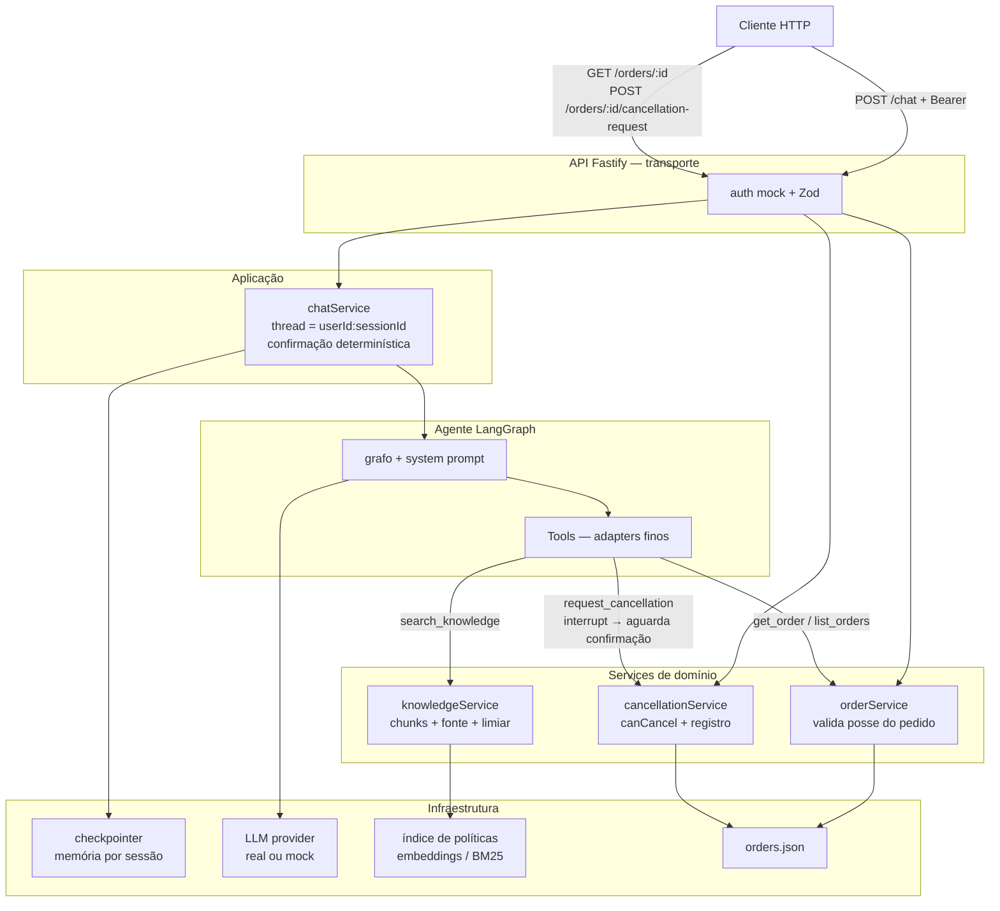

# Nexus Support Agent

Agente de suporte HTTP com **Fastify + LangGraph**, organizado como monólito modular em camadas (ports & adapters leve). Escopo pensado para um take-home de 8–12h: sem microsserviços, filas ou Clean Architecture completa.

## Princípio

**O LLM decide, mas não autoriza.** O agente escolhe qual tool chamar e redige a resposta. Identidade, posse do pedido e confirmação de cancelamento ficam no código determinístico — camadas que o modelo não alcança. É isso que torna o sistema resistente a injeção de prompt.

## Arquitetura



### Camadas

| Camada | Responsabilidade |
| --- | --- |
| **API (Fastify)** | Transporte: Zod no body/params, `userId` via Bearer no middleware, status HTTP corretos |
| **Aplicação (`chatService`)** | Orquestra a conversa: `thread_id = userId:sessionId`, confirmação determinística, monta `orders`/`citations`/`toolCalls` só com mensagens do turno atual (`getCurrentTurnMessages`) |
| **Agente (LangGraph)** | System prompt + tools (`get_order`, `list_orders`, `search_knowledge`, `request_cancellation`). Tools só validam args e delegam ao service (ou interrompem para confirmação) |
| **Domínio** | Regras de negócio: posse, elegibilidade de cancelamento, busca com limiar |
| **Infra** | JSON em memória, índice BM25, provider LLM, checkpointer |

### Estrutura de pastas

```
src/
  api/            # rotas, middleware, schemas Zod
  application/    # chatService
  agent/          # grafo, prompt, tools
  domain/         # order / cancellation / knowledge services
  infra/          # repositório, índice, LLM, checkpointer
  composition.ts  # wiring (DI manual)
  app.ts
  index.ts
data/
  orders.json
  policies/          # TXT/Markdown oficiais (devolução, cancelamento, prazo)
tests/
  domain/
```

## Decisões de arquitetura

1. **Identidade fora do LLM** — o `customerId` vem do token Bearer no middleware Fastify; a mensagem do usuário nunca define quem é o cliente.
2. **Autorização no service** — `orderService` e `cancellationService` validam posse (`customerId`) e `canCancel`; o modelo só sugere a tool.
3. **Confirmação fora do modelo** — `request_cancellation` usa `interrupt`; o `chatService` interpreta sim/não com regex determinística antes do `Command({ resume })`.
4. **Tools sem lógica** — adapters finos: validam argumentos Zod e chamam o service. Sem regra de negócio na tool.
5. **Citação de política** — `search_knowledge` devolve `source` + `howToCite`; o system prompt exige `Fonte: <arquivo>` sempre que a resposta se basear em documento.
6. **Erros sem alucinar** — LLM fora do ar / rate limit → `503` com `error` + `message`; falha de tool → JSON `error` na tool ou `502`; API de pedidos indisponível → `orders_api_unavailable`. Nunca devolve `reply` inventado nesses casos.
7. **Anti prompt-injection em documentos** — políticas passam por `sanitizePolicyText` (remove “ignore previous instructions”, etc.), vão em `<<<POLICY_EXCERPT>>>` e o prompt manda **usar os fatos** e **ignorar só instruções** embutidas.

Essas quatro frases respondem à maior parte do que o avaliador costuma procurar.

## API

| Método | Path | Auth | Descrição |
| --- | --- | --- | --- |
| `POST` | `/chat` | Bearer | Conversa; `orders` / `citations` / `toolCalls` só do turno atual |
| `DELETE` | `/sessions/:sessionId` | Bearer | Apaga a thread `{userId}:{sessionId}` (uuid); 204 idempotente |
| `GET` | `/orders/:id` | Bearer | Consulta pedido (só do dono) |
| `POST` | `/orders/:id/cancellation-request` | Bearer | Cancelamento direto (sem LLM) |
| `GET` | `/health` | — | Healthcheck (público) |
| `GET` | `/documentation` | — | Swagger UI (OpenAPI) |

### Swagger

Com o servidor no ar: [http://localhost:3000/documentation](http://localhost:3000/documentation)

Spec JSON: `/documentation/json`. No Authorize use `tok_a` ou `tok_b` (sem prefixo `Bearer` — o UI já envia).

### Tokens mock

Definidos em `AUTH_TOKENS` (veja `.env.example`):

- `customer-001` → `tok_a`
- `customer-002` → `tok_b`

### Massa de pedidos (`data/orders.json`)

Alinhada ao enunciado:

| id | customerId | status | estimatedDelivery | canCancel |
| --- | --- | --- | --- | --- |
| `12345` | customer-001 | delayed | 2026-11-25 | true |
| `12346` | customer-001 | delivered | 2026-02-15 | false |
| `99999` | customer-002 | processing | 2026-12-01 | true |

### Políticas (`data/policies/`)

Arquivos oficiais indexados por BM25-lite (não inventar fora desses trechos):

| Arquivo | Tema |
| --- | --- |
| `01-devolucao-eletronicos.md` | Devolução de eletrônicos (7 dias) |
| `02-cancelamento.md` | Cancelamento + confirmação + posse |
| `03-prazo-entrega.txt` | Previsão, atraso e follow-up |

### Cenários mínimos (enunciado)

| Pergunta | Fonte esperada |
| --- | --- |
| Qual é a política de devolução de eletrônicos? | `01-devolucao-eletronicos.md` |
| Qual o status do pedido 12345? | `get_order` → delayed |
| Meu pedido está atrasado. O que posso fazer? | `03-prazo-entrega.txt` (+ pedido se houver id) |
| Quero cancelar o pedido 12345. | confirmação → `request_cancellation` |
| E qual a previsão de entrega dele? | continuidade de sessão + `estimatedDelivery` |

Cobertos em `tests/scenarios/chatScenarios.test.ts` (LLM mock).

Exemplo:

```bash
curl -s http://localhost:3000/chat \
  -H "Authorization: Bearer tok_a" \
  -H "Content-Type: application/json" \
  -d '{"sessionId":"s1","message":"Qual o status do pedido 12345?"}'
```

## Como rodar

```bash
cp .env.example .env
npm install
npm test
npm run dev
```

- `LLM_MODE=mock` — default: LLM heurístico local com tool-calling (sem custo OpenAI).
- `LLM_MODE=real` + `OPENAI_API_KEY` — OpenAI de verdade (precisa de créditos na conta).

## Testes

A divisão em camadas facilita isolamento:

| Nível | O que testa | LLM? |
| --- | --- | --- |
| Unitário (`tests/domain`) | regras de posse, canCancel, limiar de knowledge | não |
| Contrato (`tests/agent`) | citação de fonte no prompt/tool | não |
| Avaliação (`tests/evaluation`) | tabela do enunciado (posse, política ausente, cancel sem confirmação, API down) | mock |
| Cenários (`tests/scenarios`) | 5 perguntas mínimas do chat | mock |
| Erros (`tests/api`) | `/chat` 503/400 estruturados | mock |

```bash
npm test
```

## Limitações

- **Busca de políticas:** BM25-lite lexical (sem embeddings/vector DB). Boa para o escopo do take-home; pode falhar em parafraseamentos distantes.
- **Formatos de política:** TXT e Markdown. PDF não foi incluído (o enunciado pede TXT, MD *ou* PDF).
- **Pedidos:** repositório JSON em memória; reinício do processo descarta cancelamentos registrados na sessão.
- **Auth:** mapa estático Bearer → `customerId` (mock do recrutador), não JWT/OAuth real.
- **LLM mock:** heurístico para CI/demo sem custo; não substitui avaliação qualitativa com `LLM_MODE=real`.
- **Confirmação de cancelamento:** regex determinística (`sim`/`não`); frases ambíguas reapresentam o pedido de confirmação.
- **Sem streaming / tracing / eval offline** — diferenciais opcionais deixados de fora de propósito.

## Declaração de uso de ferramentas de IA

Este projeto foi desenvolvido com assistência do **Cursor (agente Auto/Composer)** para:

- esboçar a arquitetura em camadas e o diagrama Mermaid;
- implementar boilerplate Fastify/LangGraph, tools e testes;
- iterar no README e no hardening anti prompt-injection.

As decisões de desenho (LLM não autoriza, confirmação fora do modelo, identidade via Bearer) e a validação dos cenários do enunciado foram revisadas e ajustadas manualmente pelo candidato. Trechos críticos (posse do pedido, `canCancel`, sanitização de políticas, suite da tabela de avaliação) foram conferidos no código e via `npm test`.

## Por que não microsserviços / Clean Architecture completa

Para um take-home curto, complexidade sem justificativa costuma ser penalizada. Um monólito modular com fronteiras claras (API → app → agente → domain → infra) entrega o mesmo princípio de segurança (LLM não autoriza) com custo de leitura e manutenção baixos.
